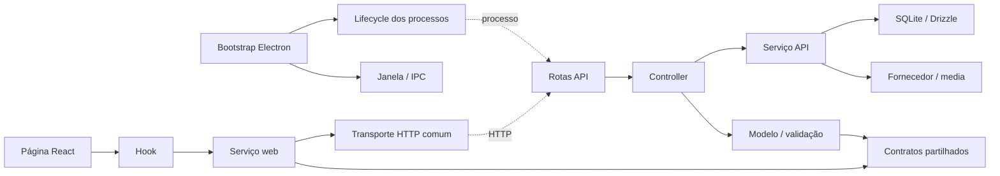

# Arquitetura e desenvolvimento da Zeus

A Zeus tem três aplicações com responsabilidades distintas e um único lockfile npm. Os comandos da raiz são a referência para instalar, verificar, compilar e empacotar o projeto. As aplicações não importam a implementação umas das outras.

## Organização

```text
apps/
  api/src/
    index.ts                  # servidor e encerramento
    app.ts                    # composição HTTP
    middleware/               # política HTTP e tradução de erros
    modules/<funcionalidade>/
      routes.ts               # URLs, métodos, guards e handlers
      controllers.ts          # entrada/saída HTTP
      models.ts               # schemas e tipos locais
      service.ts              # casos de uso e persistência
    modules/iptv/
      controllers/            # catálogo, guia e reprodução
      models/                 # regras puras e preferências
      services/               # fornecedores, cache, media e sessões
    db/                       # SQLite, Drizzle, schema, migrações e seed
    lib/                      # configuração, cifra, fetch seguro e erros de domínio
  web/src/
    main.tsx                  # bootstrap React
    app/                      # composição das rotas
    features/<funcionalidade>/
      pages/                  # ecrãs
      components/             # UI específica, quando existe
      hooks/                  # estado e lifecycle React
      services/               # operações HTTP e adaptação de respostas
      models/                 # tipos e transformações da funcionalidade
      styles/                 # CSS da funcionalidade
    features/shell/           # navegação e pesquisa que compõem funcionalidades
    shared/                   # UI, hooks, modelos, gráficos e transporte comuns
  desktop/src/
    main.js                   # composição Electron
    engine-process.js         # entrypoint do processo Motor
    engine.js                 # composição e controlo HTTP local do Motor
    preload.js                # bridge IPC limitada
    controllers/              # janela e IPC
    services/                 # processos, torrents e FFmpeg
packages/
  contracts/                  # contratos puros usados pela API e web
  local-config/               # configuração persistida e ambiente dos subprocessos
```

Uma funcionalidade pequena usa ficheiros com papéis explícitos; uma funcionalidade maior usa subpastas. Só se criam pastas com código real. Não há camadas vazias nem classes base obrigatórias.

## Direção das dependências



- **Rotas** declaram transporte e autorização. A ordem dos guards é explícita e testada.
- **Controllers** interpretam o pedido, validam dados e produzem a resposta. Não decidem regras de negócio nem executam consultas SQL diretamente.
- **Serviços** implementam casos de uso. Não recebem um Context Hono; usam dados, Request/Response nativos nas integrações de autenticação e streaming, e erros de domínio convertidos pela camada HTTP.
- **Modelos** descrevem dados e regras puras. O schema Drizzle central permanece junto da infraestrutura de persistência: há uma base SQLite e um conjunto real de relações, não um ORM artificial por funcionalidade.
- **Hooks** gerem lifecycle, cache React e estado. Os serviços web concentram operações HTTP; páginas compõem UI e ações.
- **Shared** não depende de funcionalidades. A funcionalidade `shell` compõe navegação/pesquisa de Cinema e TV; essa composição não pertence aos elementos genéricos de UI.
- **Contratos partilhados** não incluem Hono, SQLite, segredos, React ou Electron. Evitam importações web → API e cópias divergentes dos mesmos tipos.
- **Desktop** gere processos separados e uma bridge mínima. Serviços de torrents e FFmpeg têm lifecycle explícito; clientes, processos e streams têm cancelamento/cleanup.

O ESLint verifica dependências proibidas entre aplicações, shared/funcionalidades e serviços/controllers. `tests/architecture.test.ts` verifica que essas regras rejeitam importações invertidas e permitem contratos públicos.

## Padrões usados

1. **Organização por funcionalidade e por responsabilidade:** uma mudança de negócio fica perto dos respetivos modelos, serviços, controllers e testes.
2. **Composição:** os entrypoints montam módulos; não há hierarquias de herança nem service locator global.
3. **Injeção de dependências onde há variação real:** clientes, fetch e processos podem ser substituídos por fixtures nos testes; não se cria uma interface para cada função só por convenção.
4. **Adaptação de fornecedores:** dados M3U/Xtream/Add-ons são normalizados antes de chegar à UI. A UI usa contratos Zeus.
5. **Erros de domínio:** serviços comunicam falhas sem depender de Hono; a camada HTTP define o status/resposta pública.
6. **Hooks e lifecycle explícito:** reprodução, persistência e UI têm responsabilidades distintas; abortar, sair e repetir pedidos não deixam processos ou estado obsoleto.

Evitar abstrações que apenas delegam uma chamada sem acrescentar uma responsabilidade. Usar funções com nomes claros e interfaces pequenas; classes só quando o estado e invariantes justificam a sua existência.

## Ferramentas

- **Prettier:** `.prettierrc.json`, `.prettierignore` e `.editorconfig`; dois espaços, LF, sem decisões de estilo por ficheiro.
- **ESLint:** configuração flat em `eslint.config.mjs`, regras recomendadas JS/TS, variáveis não usadas, Rules of Hooks, dependências dos hooks e fronteiras de arquitetura. `eslint-config-prettier` evita regras de estilo contraditórias.
- **TypeScript:** modo strict, versão 6.0.3 alinhada com a faixa suportada pelo parser typescript-eslint. Typecheck continua separado de lint.
- **Tipos externos:** o lint não proíbe globalmente `any` nas integrações legadas. Tipar e validar dados na entrada continua a ser a norma; não se afirma que todo o legado tenha tipagem completa.
- **Exclusões deliberadas:** dependências, builds, artefactos de teste, protótipos visuais históricos, cópias de arte de referência, dados seed gerados e evidência de auditoria. Código executável atual das três aplicações, packages, scripts e testes é verificado.

```sh
npm ci
npm run dev

npm run format          # aplicar formatação
npm run format:check    # verificar sem alterar
npm run lint            # zero erros e zero avisos
npm run lint:fix         # correções automáticas seguras
npm run typecheck
npm test
npm run build
npm run check           # format + lint + types + tests + build
```

Testes browser e desktop são complementares: `test:cinema`, `test:tv`, `test:desktop`, e os restantes comandos documentados no README. Usam perfis temporários/fixtures; não usar contas nem fornecedores reais para testar uma refatoração.

## CI e distribuição

`.github/workflows/checks.yml` corre em **pull request e push**: instalação reproduzível (`npm ci`), formatação, lint, typecheck, testes, dependências, SAST, segredos e build. Falhas bloqueiam esse job; execuções antigas da mesma branch são canceladas. A obrigação técnica de passar antes de merge depende de branch protection/rulesets do repositório.

`.github/workflows/macos-release.yml` é a entrega manual dos instaladores: repete os checks, compila e testa os pacotes arm64/x64 nos respetivos runners e guarda os artefactos. Assinatura/notarização são opcionais por configuração e exigidas para distribuição pública. Não publica automaticamente nem instala a aplicação em máquinas de utilizadores.

Fluxo habitual: branch → alteração pequena com testes → `npm run check` → PR/revisão → checks verdes → merge → workflow manual de instaladores quando se pretende lançar uma versão. Não incluir refatorações não relacionadas numa correção de segurança.
